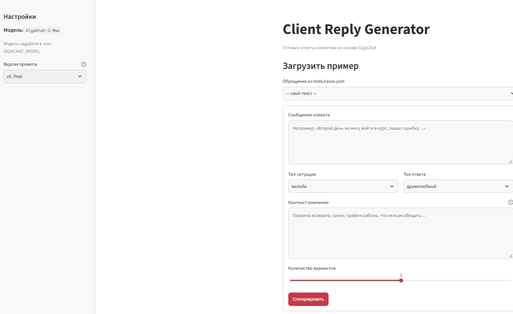
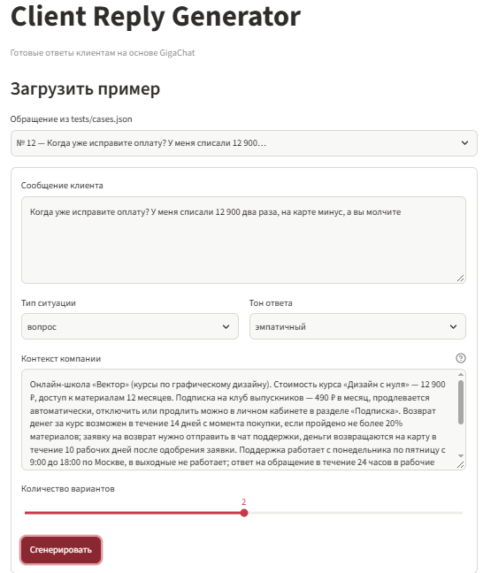
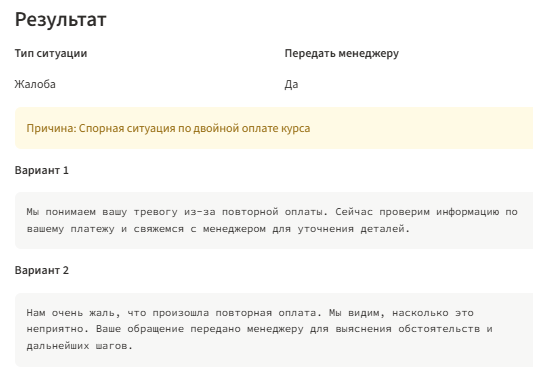
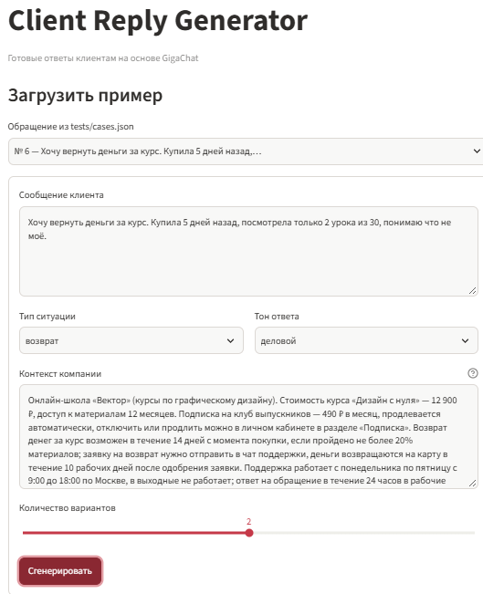
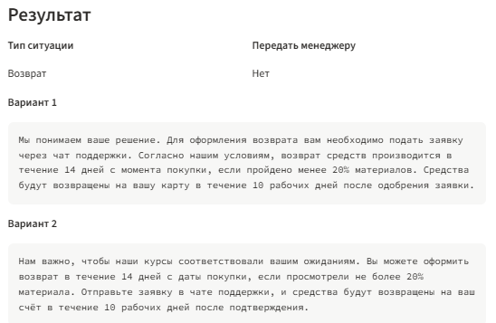
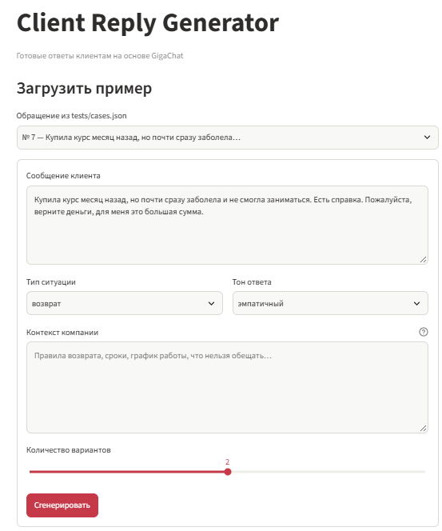
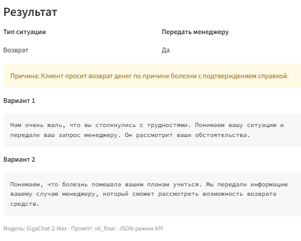
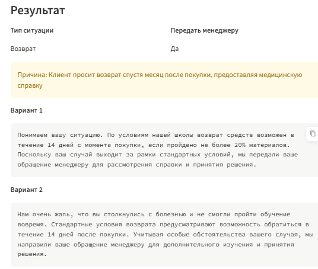

# Client Reply Generator

Генератор ответов клиентам: по сообщению клиента, типу ситуации, тону и контексту компании сервис готовит 1-3 варианта ответа, определяет реальный тип обращения и подсказывает, нужно ли передать вопрос менеджеру.

Учебный проект (MVP) для портфолио. Работает локально, использует GigaChat API.



## Зачем это нужно

Ответы клиентам (жалобы, вопросы, возвраты, возражения) отнимают время и получаются неровными: то слишком сухо, то слишком эмоционально. Хуже всего, когда в ответе появляются обещания, которых компания не давала (сроки, компенсации, скидки), и когда сложный случай не уходит менеджеру.

Сервис рассчитан на специалиста поддержки или владельца малого бизнеса, который отвечает клиентам в мессенджерах и по почте. Программировать для работы с ним не нужно: достаточно веб-формы.

## Что умеет

- принимает сообщение клиента, тип ситуации (жалоба, вопрос, благодарность, возврат, возражение), тон ответа (дружелюбный, деловой, эмпатичный), контекст компании и число вариантов (1-3);
- возвращает варианты ответа, определённый тип ситуации (может отличаться от выбранного: скрытую жалобу в «вопросе» сервис замечает) и флаг «передать менеджеру» с причиной;
- отвечает модель в JSON-режиме GigaChat API (структурированный ответ по схеме);
- отвечает только по контексту компании: правила в промпте запрещают выдумывать условия, сроки и компенсации;
- проверяет готовые ответы на слова-обещания («оперативно», «немедленно», «завтра», «гарантия» и другие) и на просьбы прислать данные, которых нет в контексте; при находке один раз (по умолчанию до трёх раз) перегенерирует ответ, а если не получилось, показывает предупреждение «проверьте текст перед отправкой»;
- содержит 12 готовых тестовых обращений и выбор примера прямо в интерфейсе.

## Скриншоты

**Определение скрытой жалобы** (в форме выбран тип «вопрос», сервис определил «Жалобу» и передал менеджеру):




**Возврат по правилам** (названы условия, заявка в чат поддержки, срок возврата):




**Один и тот же случай без контекста и с контекстом компании** (возврат через месяц по болезни):

Без контекста:




С контекстом:




## Быстрый старт (Windows, PowerShell)

Нужны Python 3.10 или новее (проект проверен на 3.11.9), Git и ключ авторизации GigaChat API (личный кабинет на developers.sber.ru).

```powershell
git clone https://github.com/pdzigovskij-del/client-reply-generator.git
cd client-reply-generator
python -m venv .venv
.\.venv\Scripts\python.exe -m pip install -r requirements.txt
copy .env.example .env
```

Откройте `.env` в блокноте и впишите ключ авторизации в `GIGACHAT_CREDENTIALS` и `GIGACHAT_SCOPE=GIGACHAT_API_PERS` (для личного использования). Файл `.env` в репозиторий не попадает.

### Сертификаты Минцифры

GigaChat использует сертификаты НУЦ Минцифры, которых нет в хранилище Python. Скрипт скачивает их с gu-st.ru и собирает файл `.certs/gigachat_ca_bundle.pem`:

```powershell
.\.venv\Scripts\python.exe setup_certs.py
```

Скрипт печатает отпечатки SHA256 сертификатов, их можно сверить с официальными данными. Если файл уже есть, скрипт ничего не перезаписывает без флага `--force`. Путь к файлу указан в `.env.example` (`GIGACHAT_CA_BUNDLE`).

### Проверка доступа и запуск

```powershell
.\.venv\Scripts\python.exe check_gigachat.py --ca-bundle .certs\gigachat_ca_bundle.pem
.\.venv\Scripts\python.exe -m streamlit run app.py
```

Первая команда проверяет, что токен выдаётся, модель отвечает и работает JSON-режим. Вторая открывает веб-интерфейс (обычно `http://localhost:8501`).

## Настройки (`.env`)

| Переменная | Назначение |
|---|---|
| `GIGACHAT_CREDENTIALS` | ключ авторизации (хранится только локально) |
| `GIGACHAT_SCOPE` | область доступа, для личного использования `GIGACHAT_API_PERS` |
| `GIGACHAT_MODEL` | модель, в проекте использована `GigaChat-2-Max` |
| `GIGACHAT_TEMPERATURE` | температура, 0.3 |
| `GIGACHAT_GUARD_RETRIES` | число перегенераций защиты, 3 |
| `PROMPT_VERSION` | версия промпта из папки `prompts/`, по умолчанию `v6_final` |
| `GIGACHAT_CA_BUNDLE` | путь к файлу сертификатов Минцифры |

Отключение проверки SSL (`GIGACHAT_VERIFY_SSL`) возможно только временно для локальной проверки. В рабочем коде его не используйте.

## Как выбирался промпт

Промпт разрабатывался итерациями: шесть версий лежат в `prompts/`, тестовый набор из 12 обращений вымышленной онлайн-школы «Вектор» лежит в `tests/cases.json` (для каждого обращения заданы ожидаемый тип ситуации, ожидаемая передача менеджеру, проверки `checks` и запреты `must_not`). Прогон выполняет `compare_prompts.py`, результаты сохраняются в `reports/`.

| Версия | Идея | Что показал прогон |
|---|---|---|
| `v1_short` | короткие правила и формат JSON | ошиблась в типе ситуации в скрытой жалобе (№12), просила у клиента данные карты |
| `v2_rules` | подробные запреты, критерии эскалации, тон | категорический отказ в возврате (№7), выдуманные условия |
| `v3_examples` | правила v2 и два примера | лучшая по самым рискованным случаям, но выдумки в ответах на возражения |
| `v4_strict` | запрет выдумок, запросов данных и обещаний сроков, обязательное упоминание менеджера | запрет слов-обещаний модель частично игнорировала |
| `v5_final` | точечные правила (выходные, пустые фразы, условия возврата, род) | в возвратах писала «мы приняли вашу заявку», в жалобе с угрозой просила «воздержаться от поспешных решений» |
| `v6_final` | правила для возврата, угроз жалобами и слов-обещаний | выбрана основной |

Главный вывод: запрет слов-обещаний в промпте модель выполняет не всегда, поэтому добавлена защита в коде (`reply_service.py`): ответ проверяется по корням слов, при находке запрашивается перегенерация, если слова остались, пользователь видит предупреждение.

### Повторные запуски (стабильность)

Модель отвечает не одинаково при каждом запуске, поэтому для самых рискованных обращений (№3, №6, №7, №9, №11) выполнено по 5 запусков на версию. Ответы оценивались вручную по `checks` и `must_not`:

| Обращение | v5_final | v6_final |
|---|---|---|
| №3 рассрочка | 4/5 | 4/5 |
| №6 возврат по правилам | 0/5 | 5/5 |
| №7 возврат вне правил, справка | 5/5 | 2/5 |
| №9 возражение «дорого» | 1/5 | 1/5 |
| №11 угроза Роспотребнадзором | 2/5 | 5/5 |
| Итого чистых ответов | 12/25 | 17/25 |

Оценка ручная и в части случаев субъективная. Полные тексты ответов лежат в `reports/stability.md` и `reports/stability_2.md`.

## Известные ограничения

- В ответах на возражения («дорого», №9) модель добавляет детали, которых нет в контексте («эксклюзивные материалы», «обратная связь экспертов»): в 9 ответах из 10. Причина в том, что в тестовом контексте нет списка преимуществ. В реальной работе укажите их в поле «Контекст компании».
- В ответах про возврат при болезни (№7) модель в части запусков пишет «передали вместе со справкой», хотя справка не передавалась.
- Автоматическая проверка ловит только слова-обещания и запросы данных. Выдуманные факты и неточные формулировки она не видит, поэтому тексты ответов нужно проверять глазами перед отправкой клиенту.
- В тестах (`compare_prompts.py`) использовался один вариант ответа на обращение.
- Тестовый набор небольшой (12 обращений, одна вымышленная компания), результаты не претендуют на статистическую значимость.
- Модель GigaChat работает в один поток и доступна по бесплатному тарифу Freemium только для личного некоммерческого использования; условия тарифа проверяйте в документации Сбера.

## Структура проекта

```
client-reply-generator/
├── app.py                 # интерфейс Streamlit
├── reply_service.py       # вызов GigaChat, JSON, защита от слов-обещаний
├── compare_prompts.py     # прогон и сравнение версий промпта
├── check_gigachat.py      # проверка доступа к API
├── setup_certs.py         # загрузка сертификатов Минцифры
├── requirements.txt
├── .env.example
├── prompts/               # версии промпта v1-v6
├── tests/cases.json       # 12 тестовых обращений и контекст компании
├── reports/               # результаты прогонов и сравнения
├── docs/spec.md           # описание проекта
├── images/                # скриншоты для README
└── .claude/skills/client-reply-generator/SKILL.md  # скилл для Claude Code
```

## Скилл для Claude Code

В репозитории есть скилл `.claude/skills/client-reply-generator/SKILL.md`. Он описывает структуру проекта, запуск на Windows, работу с версиями промпта и защитой от слов-обещаний, проверку типичных ошибок, обновление README и подготовку к публикации.

Claude Code подхватывает скилл автоматически, когда задача связана с этим репозиторием. Можно и явно попросить: «используй скилл client-reply-generator». Скилл не читает `.env`, не отключает проверку SSL и не запускает массовые запросы к GigaChat без подтверждения.

## Запуск сравнения промптов

Примеры (все запросы идут по очереди, с паузой):

```powershell
# одна версия на всех обращениях
.\.venv\Scripts\python.exe compare_prompts.py --versions v6_final --force --pause 1.5

# повторы на выбранных обращениях
.\.venv\Scripts\python.exe compare_prompts.py --versions v6_final --cases 4,11,12 --repeat 3 --force
```

Результаты дописываются в `reports/results.jsonl` после каждого запроса, поэтому прогон можно продолжить после сбоя: готовые пары пропускаются.

## Статус

MVP для учебного портфолио. Не предназначен для автоматической отправки ответов клиентам без проверки человеком.
